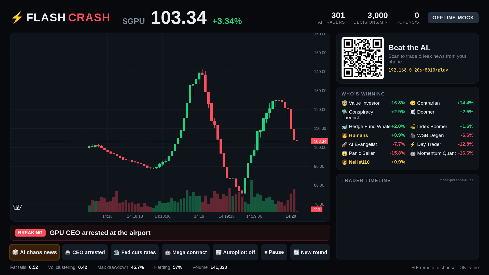

# ⚡ Flash Crash

**Your family vs. 300 AI traders, live on the living-room TV.**

Flash Crash is a party game: a stock market of four fake companies, run by hundreds of LLM agents with
personalities, including Reddit degens, Buffett-style value investors, panic-selling retirees, momentum quants,
conspiracy theorists and hedge-fund whales:

| Stock | Company | Character |
|---|---|---|
| **$GPU** | Green Processing Unlimited | AI chip maker, deep and steady |
| **$ROBO** | RoboRide | self-driving robotaxi fleet |
| **$NOVA** | Nova Fusion | fusion power startup |
| **$MEME** | Doge Burger | meme-stock fast food, thin book, wild swings |

The market plays out on the **Fire TV**. Everyone in the room scans a QR code and trades against the AIs from their phone,
or **leaks fake breaking news** ("Doge Burger adds a $1,000 golden burger") by typing or speaking it. The headline is routed
to the company it names, every agent that's watching reads it, argues about it on its timeline, and trades. Bubbles, panics
and flash crashes emerge on their own. Play free-form or in **timed 5-minute rounds** that end on a podium with an AI sportscaster recap.

But careful: an **AI SEC** watches for insider trading. Buy a stock, leak good news about it and profit, and you may get
busted on the big screen. And whenever a stock rips or crashes, an **AI forensics analyst** explains why: the headline and
which trader personalities drove it, with dollar flows.
**Alexa+** (or any AI agent) can join in over **MCP**: *"Alexa, leak that RoboRide just got approved in every city."*



## How it works

```
 phones (/play) ──trade, leak news, voice──┐
 Fire TV app (WebView, D-pad) ── /tv ──────┤        ┌──────────── Simulation ─────────────┐
 Alexa+ / agents ── MCP /mcp ──────────────┼──▶ FastAPI ─▶ 300 agents ─▶ LLM brain (async pool)
                                           │        │      │ persona + portfolio + news +    │
 Tavily real headlines ────────────────────┘        │      │ "timeline" of other agents     │
                                                    │      ▼                                 │
                                                    │  price-time-priority order book        │
                                                    │  + market maker, 2s candles, analytics │
                                                    └──────────── WebSocket push ────────────┘
```

* **Agents** (`flashcrash/personas.py`): 11 archetypes. Each agent has its own name, bankroll, risk appetite, favourite
  stocks, private fair-value beliefs, a **posting quirk** (talks like a pirate, quotes Sun Tzu, blames the Fed, ...) and a
  short memory of its last posts.
* **Attention**: each turn an agent picks a stock to look at: mostly its favourites, but fresh headlines and big moves pull
  the whole crowd in, so money rotates between stocks as the news breaks.
* **Brain** (`flashcrash/brain.py`): the agent receives that stock's market (price path, best bid/ask), its holdings, the
  headlines about it and three posts from other agents' timelines, which is what makes herding contagious. It replies with JSON:
  `{"action","qty","price","thought"}`. Most agents run on a fast model; whales use a bigger reasoning model. A 24-wide async
  worker pool streams decisions into the market continuously.
* **Exchange** (`flashcrash/market.py`): one limit order book per stock with price-time priority, cash and share reservations,
  no shorting and no self-trading. Each trader has one cash wallet shared across every book. Market makers quote around a
  slow-moving average, so noise is absorbed but news gets through.
* **News routing** (`flashcrash/sim.py`): a headline that names a company hits that stock; industry words ("robotaxi",
  "fusion", "chips") find the right one; otherwise it's macro news ("Fed cuts rates") and moves everything a little.
* **Science panel**: the footer tracks *stylized facts* of real markets as they emerge: fat tails (excess kurtosis),
  volatility clustering, drawdown and a herding index.

### Five AI roles

| Role | What it does |
|---|---|
| 300 traders | personas deciding trades and posting on the timeline |
| Newsroom | invents chaos headlines on demand or on autopilot |
| AI SEC | rules on insider trading: did you trade right before your own leak, and did it pay? |
| Forensics analyst | explains every big move from the order flow by trader type |
| Sportscaster | recaps each round on the podium |

## Quick start

```bash
uv sync
cp .env.example .env        # add a key, or leave empty for offline mock mode
uv run flash-crash          # http://localhost:8000/tv  ·  phones: scan the QR code
```

With no API key, agents use rule-based persona brains (badge: **OFFLINE MOCK**) with an offline voice
(`flashcrash/chatter.py`): archetype lines, reactions to the headline, replies to other traders and quirks, never repeating,
so the full game works offline.

## The phone controller (`/play`)

A first-run tutorial, then four tabs:

* **📈 Trade**: pick a stock, see its live chart with your buys/sells and your average cost marked, pick 1/10/50/100/MAX or any
  number, buy or sell. Chart options: 2s/10s/30s/1m candles, candles or line, and **indicators**: volume, SMA 20, EMA 9,
  Bollinger Bands, VWAP, RSI 14, MACD.
* **📰 Leak**: type or speak a headline, aim it at a stock or the whole market, or let the AI newsroom write one. 20 seconds
  later you're told how much your leak moved the price.
* **💬 Chatter**: breaking news and the AI timeline, filterable to one stock.
* **💼 Portfolio**: positions with P&L, the player leaderboard, which AI personalities are winning, and your trade history.

Achievements pop up as you play (first trade, up 10%, top 10 of all traders, beating every AI type, moving a stock 5% with a leak).

### AI providers (OpenAI-compatible, pick one)

| Provider | Env | Default models |
|---|---|---|
| **Nebius Token Factory**: NVIDIA Nemotron | `NEBIUS_API_KEY` | `nemotron-3-nano-30b-a3b` (crowd), `nemotron-3-super-120b-a12b` (whales). Exact IDs are resolved from the live `/models` list |
| **Amazon Bedrock** | `AWS_BEARER_TOKEN_BEDROCK`, `AWS_REGION` | `openai.gpt-oss-20b-1:0`, `openai.gpt-oss-120b-1:0` |
| Any OpenAI-compatible API | `FLASHCRASH_PROVIDER=openai`, `LLM_BASE_URL`, `LLM_API_KEY`, `FAST_MODEL` | |

`TAVILY_API_KEY` enables the **🌍 Real news** button, which injects a live real-world AI-chip headline into the market.

## Fire TV

The `firetv/` app is a native Fire OS (Android) app: a full-screen WebView tuned for the 10-foot UI.

* **D-pad** ▲ ▼ switches the stock on the big chart (it also jumps to whichever stock is in the news); ◀ ▶ moves between
  controls; **OK** fires the selected one
* **Play/Pause** pauses the market, **Fast-forward** asks the AI newsroom for a chaos headline, **Rewind** starts a 5-minute round
* **Menu** opens server settings

```bash
# Prebuilt: dist/flash-crash-firetv.apk
# Build & sideload over Wi-Fi (enable ADB debugging on the TV first):
scripts/firetv.sh <fire-tv-ip> http://<this-computer-ip>:8000
```

The TV and phones must reach the server: use the same Wi-Fi, or set `PUBLIC_URL` to a tunnel or deployed URL.

## Alexa+ / MCP

The server exposes an MCP endpoint (spec 2025-11-25+, **Streamable HTTP**) at `/mcp` with these tools:

| Tool | What it does |
|---|---|
| `market_status` | every stock's price and move, who's winning, round clock, latest headline |
| `leak_news` | inject a headline (optionally aimed at a ticker) that every agent reacts to |
| `chaos` | ask the AI newsroom for a surprise headline |
| `explain_move` | "why did MEME crash?": the headline and trader types behind the last move |
| `trade` | buy or sell a stock for a named human player |
| `control` | start a timed round / run the scripted demo / pause / resume / reset / autopilot news |

Connect any MCP client to `http://<host>:8000/mcp`. DNS-rebinding protection only accepts requests addressed to localhost,
the LAN IP, `PUBLIC_URL` or `MCP_ALLOWED_HOSTS`.

## Demo mode

`control` → `demo` (from Alexa, `POST /api/control {"action":"demo"}`, or **D** on a keyboard on the TV page) starts a
3-minute round with a scripted news timeline, so every take of a recording hits the same beats. See
[docs/SUBMISSION.md](docs/SUBMISSION.md) for the video script and the hackathon write-ups.

## Deploy

`docker build -t flash-crash . && docker run -p 8000:8000 --env-file .env flash-crash`

## Tests

`uv run pytest`: order book invariants (cash and share conservation across 3,000 random orders, one wallet shared across
books), reply parsing for messy LLM output, news routing, chatter variety, timed rounds and an end-to-end simulation run.

## Security notes

Flash Crash is a party game meant for a home network: the phone and TV endpoints have no authentication by design. Don't
expose it to the open internet without putting auth in front. API keys stay on the server, and provider errors are reduced to
the error type before being shown on screen.

## License

MIT. Charts are rendered with [TradingView Lightweight Charts™](https://www.tradingview.com/lightweight-charts/) (Apache-2.0).
